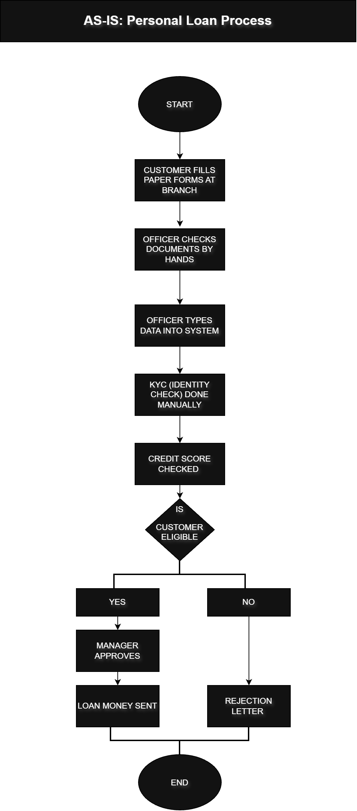
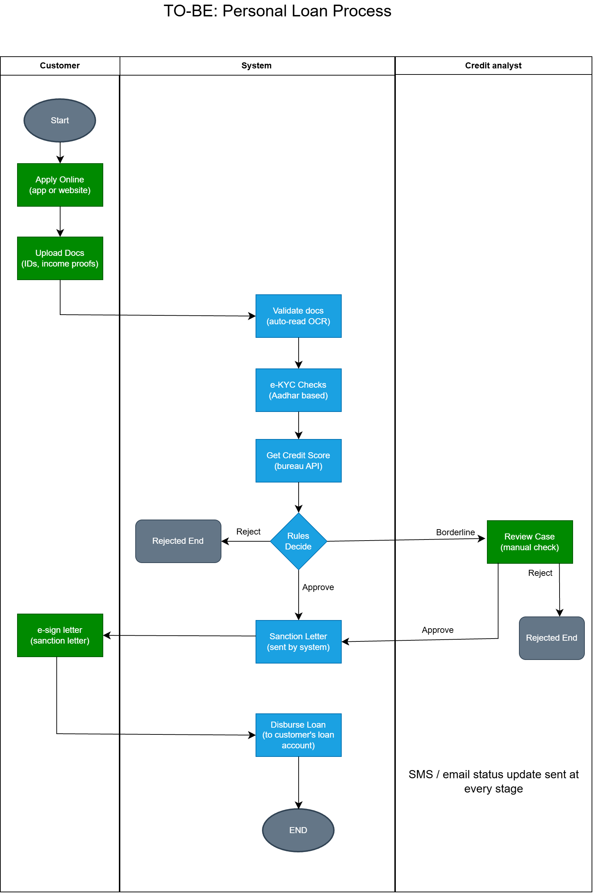
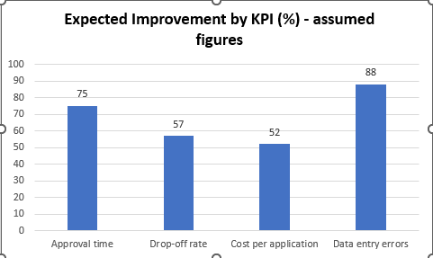

# Banking Loan Process Optimization (AS-IS to TO-BE)

A business analysis case study on improving a bank's personal loan process.

> Note: This is a simulated case study. The bank ("ABC Bank") and all figures are assumed for learning and portfolio purposes.

## The problem
ABC Bank takes about 12 days to approve a personal loan. Customers fill paper forms at the branch, staff check documents by hand, and about 35% of customers give up before getting the loan.

## What I did
1. Identified the stakeholders and their needs
2. Mapped the current process (AS-IS) and found its pain points
3. Designed an improved digital process (TO-BE) with swimlane diagrams
4. Compared the two in a gap analysis, prioritised with MoSCoW
5. Wrote 8 user stories with acceptance criteria
6. Estimated the benefits with KPIs

## Current process (AS-IS)

## Improved process (TO-BE)

## Key findings
- The main problems are manual checks, retyping of data and no status tracking.
- The root cause is that the process has no digital channel.
- In the new process only borderline cases go to an analyst. Clear cases are decided by rules.

## Expected results (assumed)
| KPI | AS-IS | TO-BE |
|---|---|---|
| Approval time | 12 days | 3 days |
| Customer drop-off | 35% | 15% |
| Cost per application | Rs 2,500 | Rs 1,200 |
| Data entry errors | 8% | 1% |

## Files in this repository
| File | What it contains |
|---|---|
| 01_problem_statement.docx | Why the project exists |
| 02_stakeholders_pain_points.docx | Stakeholders, pain points, root causes |
| 03_as_is_flow.drawio.png | Current process diagram |
| 04_to_be_flow.drawio.png / .drawio | Improved process diagram |
| 05_gap_analysis.docx | Gap analysis with MoSCoW priorities |
| 06_user_stories.docx | User stories and acceptance criteria |
| 07_kpi_benefits.docx | KPIs and expected benefits |

## Tools used
draw.io (process diagrams), Microsoft Word (documentation), Google Sheets (charts)

## What I learned
- How to map a business process step by step and show who does each task using swimlane diagrams.
- How to find the real cause of a problem (root cause analysis) instead of only listing symptoms.
- How to turn problems into requirements: a gap analysis with MoSCoW priorities, and user stories with measurable acceptance criteria.
- How to back up a proposal with KPIs, and why assumed figures must be clearly labelled.
- Next, I want to validate these assumptions with real data and learn tools like Power BI and SQL.

## Author
[Sneha Yashwant Kadam] | [www.linkedin.com/in/sneha-kadam-952845291] | [kadamsneha826@gmail.com]